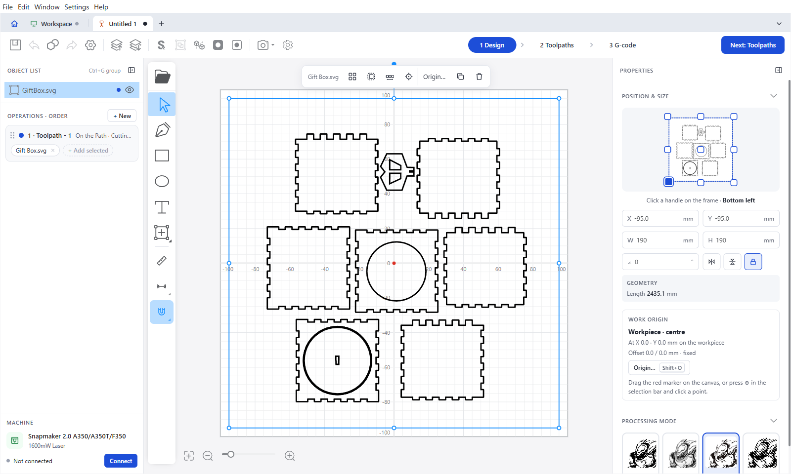
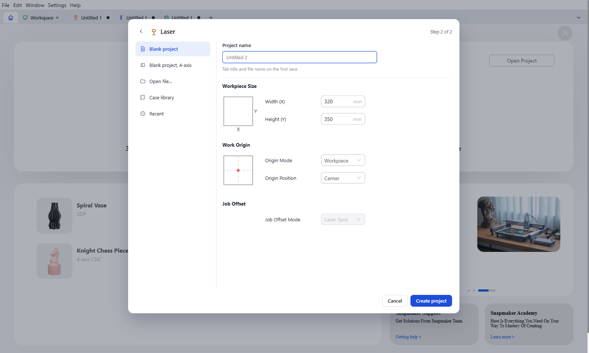
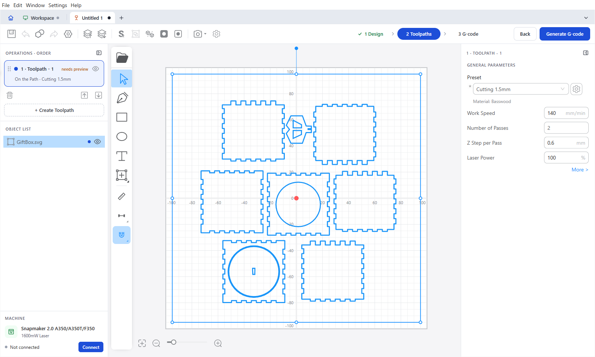
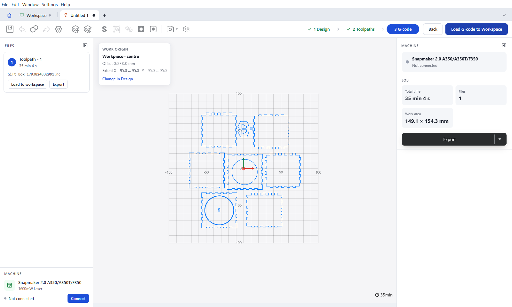
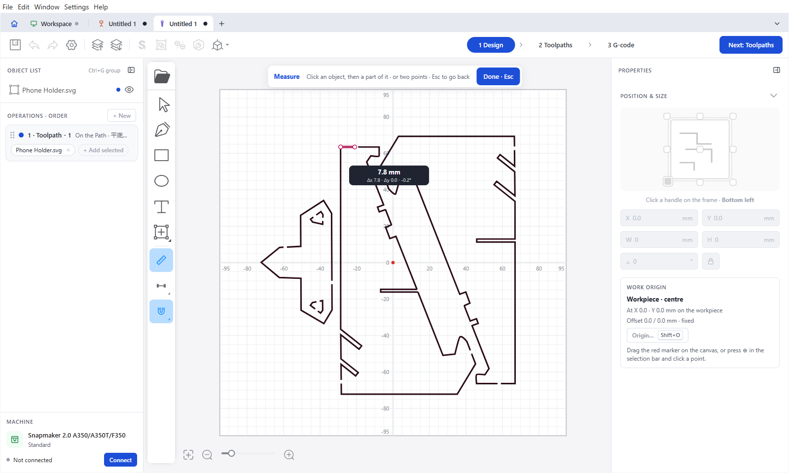
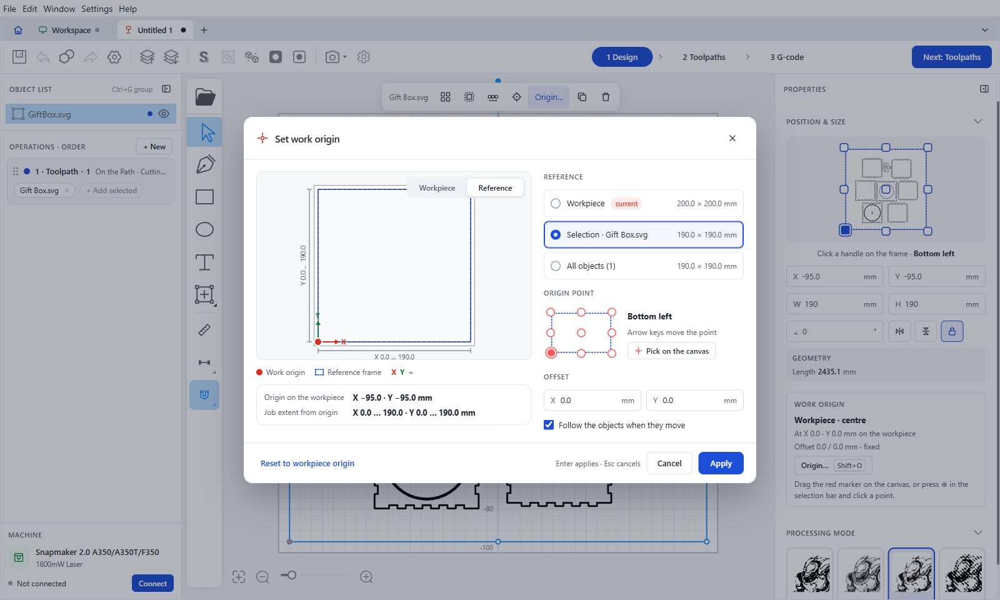
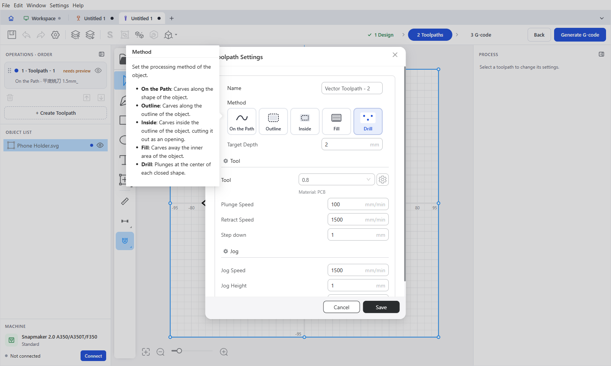

Snapmaker Luban
===============

[](https://github.com/michaelestermann/Luban/actions/workflows/build-on-pull-request.yml)

Snapmaker Luban is an easy-to-use 3-in-1 software tailor-made for Snapmaker machines.
It prepares jobs for 3D printing, laser engraving / cutting and CNC milling, and controls the machine over Wi-Fi or a serial port.

This repository is a fork of [Snapmaker/Luban](https://github.com/Snapmaker/Luban) (version **4.17.0**).
It adds a redesigned Laser / CNC editor, projects in tabs, CAD-style drawing and measuring tools, a free work origin and new CNC methods.
See [What's new](#whats-new-in-416--417) below and the [feature guide](./docs/Features.md) for details.

The software is inspired by [cncjs](https://github.com/cncjs/cncjs) by cheton.
We use [LunarSlicer](https://github.com/Snapmaker/LunarSlicer) for 3D slicing.




## What's new in 4.16 / 4.17

### Projects in tabs

Open several Laser, CNC and 3D printing projects at once and switch between them without losing undo history.
Home and Workspace are fixed tabs. The **+** button asks what you want to make, then lets you name the project, set the workpiece size and choose the work origin.
Open tabs come back on the next start, and Luban asks once for all unsaved projects when you quit.



### Laser / CNC editor in three steps

The editor walks you through **1 Design → 2 Toolpaths → 3 G-code** (keys `1`, `2`, `3`).

- **Design** – object list with groups, renaming, drag-and-drop layer order, and Shift/Ctrl selection; operations panel; selection bar; properties panel with position reference, geometry and work origin.
- **Toolpaths** – sort operations by drag and drop, and add or remove objects of a toolpath.
- **G-code** – file list (one file per tool run for CNC), job summary (time, files, work area) and the work origin in the preview.

| Toolpaths | G-code |
| --- | --- |
|  |  |

### Drawing and measuring tools

- **Measure** (`M`) objects, single parts of an object (also inside imported SVGs) or the distance between two points.
- **Dimensions** (`D`) with editable dimension chains, and **Snap** (`S`) to points, centres, edges, alignment and grid.
- **Point editing** with insert, delete and split; close open paths.
- **Combine** (weld, subtract, intersect), **Offset** (`O`), grid and circular **Array** (`A`), **round corners** and **decompose SVG** one level at a time.



### Work origin

Set the work origin to the workpiece, the selection or all objects, pick any of nine frame points, add an offset and let it follow the objects as they move.
Open the dialog with `Shift+O`, pick a point on the canvas with `0`, or place it freely with `Alt`.
The origin and its offset go into toolpaths, G-code and project files.



### CNC

- New **Inside** method that cuts inside the outline, and a **Drill** method with peck drilling at the centre of each closed shape.
- Toolpaths are split into same-tool runs, with one named G-code file per tool. All files can be loaded into the Workspace at once.



### Faster and safer

Faster toolpath and editor updates for many objects, and updated dependencies to fix known security issues.


## How to install and run

### Run released applications

Official builds of Snapmaker Luban are in the ["**Releases**"](https://github.com/Snapmaker/Luban/releases) section of the Snapmaker repository.
The features listed above are only in this fork. To use them, [build Luban from source](./docs/Development.md).

For Linux distros (Debian for example), install the `.deb` package and its dependencies:

```Bash
> sudo dpkg --install snapmaker-luban-{version}-linux-amd64.deb
> sudo apt install --fix-broken
```

### Run from source code

See [Development](./docs/Development.md) to run and develop Luban from source code (Node.js 22 or newer).


## Documentation

- [Feature guide](./docs/Features.md) – screens, workflows and keyboard shortcuts
- [Development](./docs/Development.md) – set up, run, build and test
- [Windows environment](./docs/Environment-Windows.md), [Linux environment](./docs/Environment-Linux.md), [macOS environment](./docs/Environment-macOS.md)
- [Contributing](./CONTRIBUTING.md)


## Feedback & Contribution

- To submit a bug or feature request, [file an issue](https://github.com/michaelestermann/Luban/issues/new) for this fork, or in the [Snapmaker repository](https://github.com/Snapmaker/Luban/issues/new) for the official app.
- To contribute code, read and follow our guidelines for [contributing](./CONTRIBUTING.md).


## Translations

Luban ships in 14 languages: English, Chinese (Simplified and Traditional), Czech, French, German, Hungarian, Italian, Japanese, Korean, Brazilian Portuguese, Russian, Spanish and Ukrainian.

We use Crowdin for collaborative translations. We would greatly appreciate your help in improving them.

| Language | Crowdin Link |
| ---------| -------------|
| Ukrainian (Українська) | [Ukrainian translations](https://crowdin.com/project/luban/uk) |
| German (Deutsch) | [German translations](https://crowdin.com/project/luban/de) |
| Italian (Italiano) | [Italian translations](https://crowdin.com/project/luban/it) |
| Chinese Simplified (简体中文) | [Chinese translations](https://crowdin.com/project/luban/zh-CN) |


## License

Snapmaker Luban is released under the terms of the AGPLv3 License.

The terms of the license are in the LICENSE file or at https://www.gnu.org/licenses/agpl-3.0.html.
