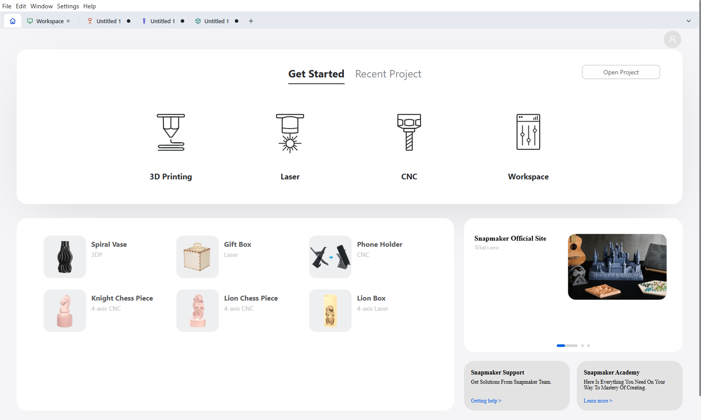
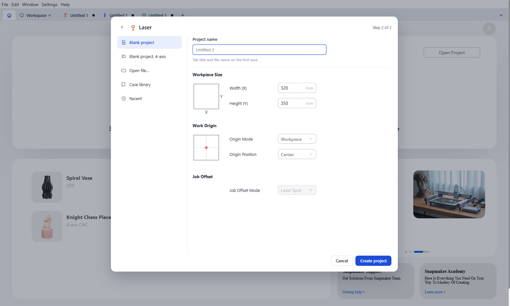
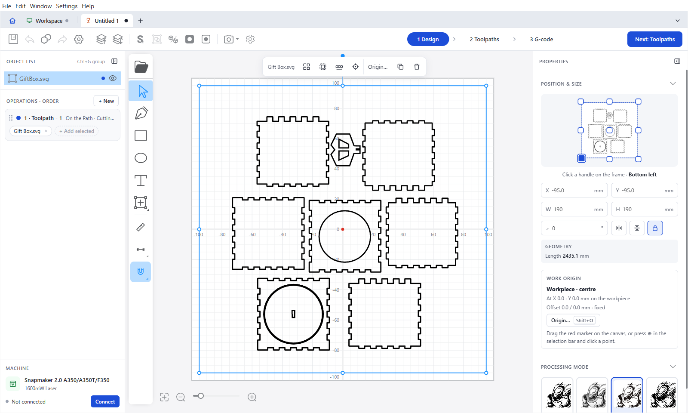
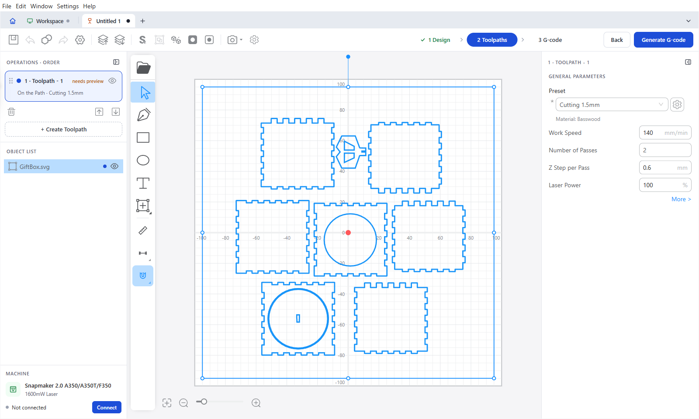
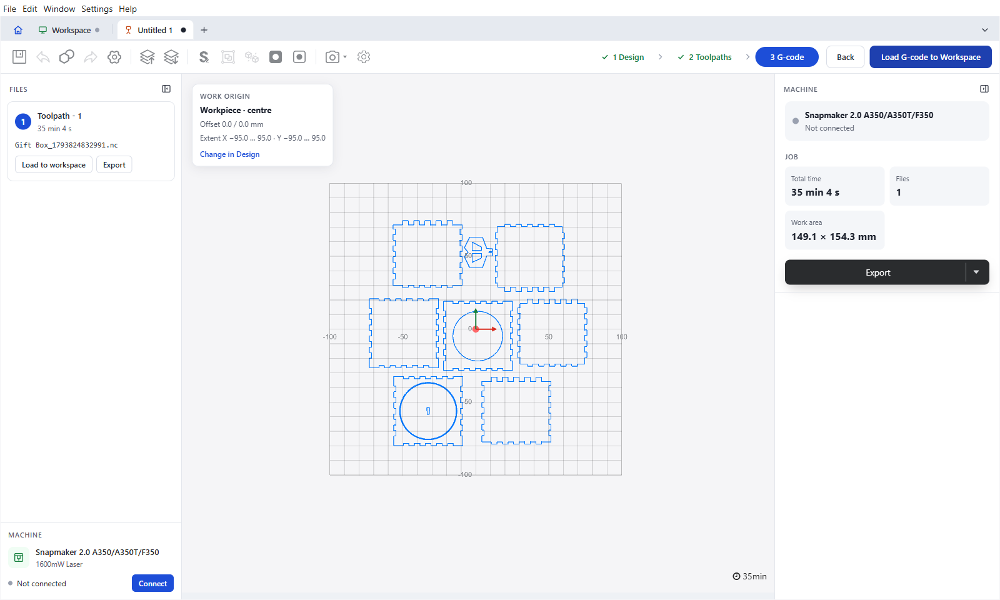
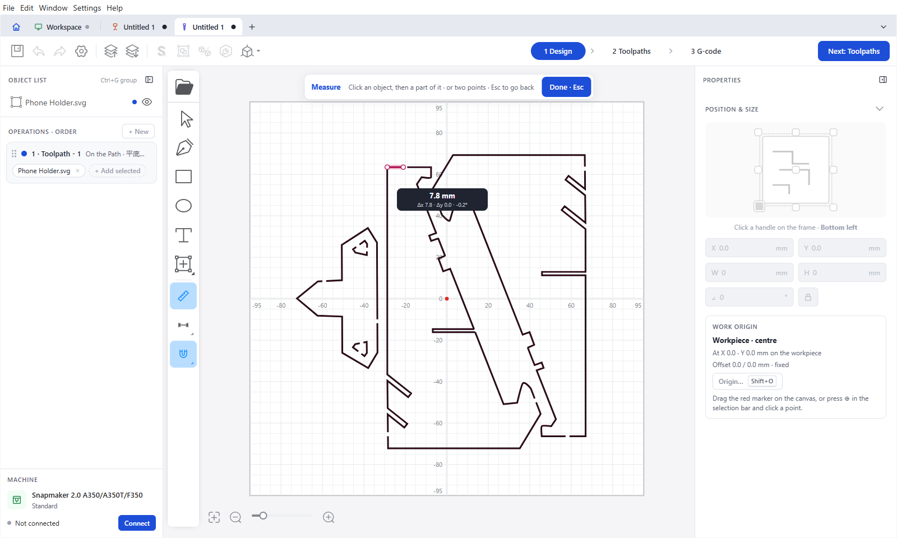
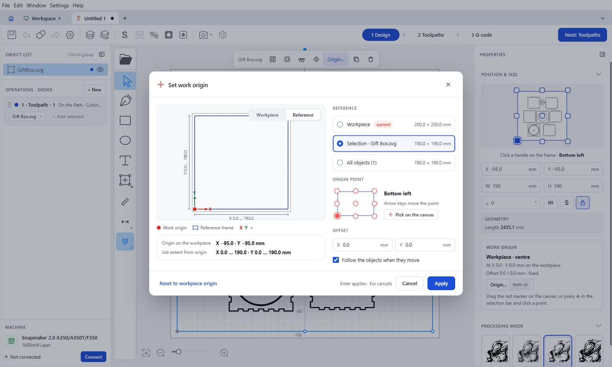
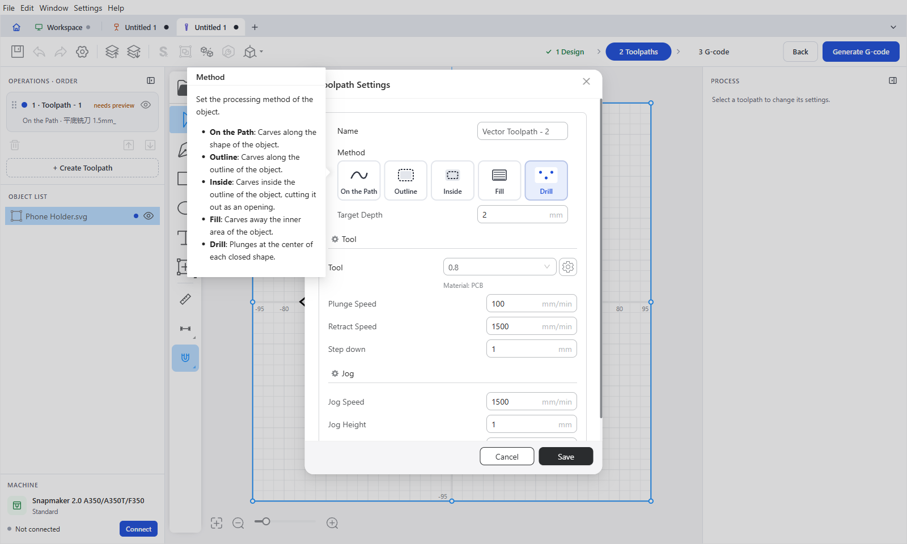
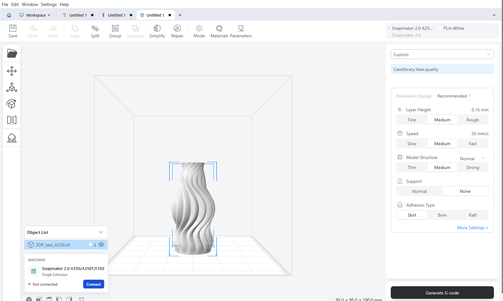
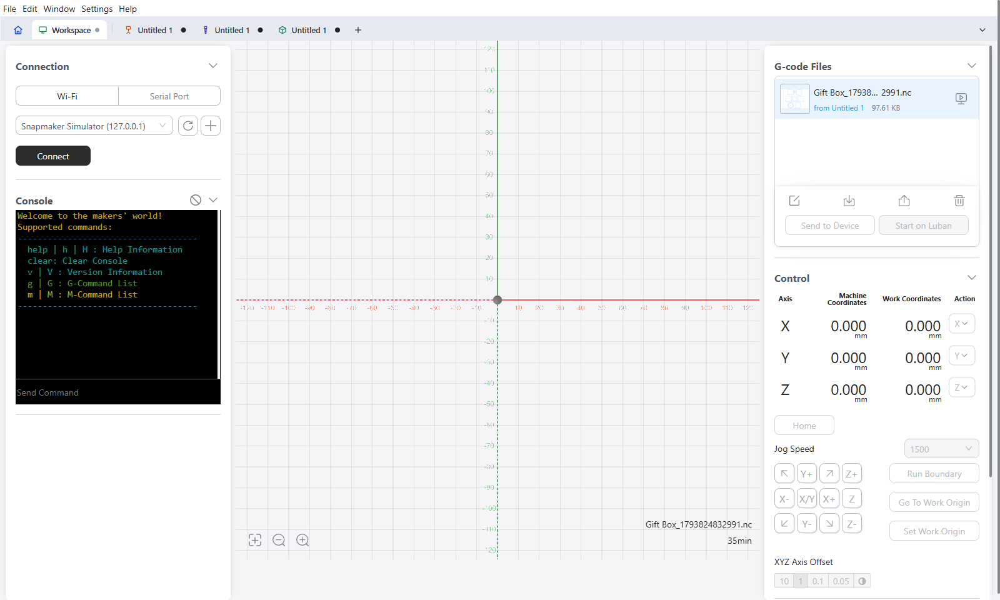

# Feature guide

This guide shows the main screens of Luban 4.17 and the features this fork adds to Snapmaker Luban.
For setup and build instructions, see [Development](Development.md).

- [Home and project tabs](#home-and-project-tabs)
- [Laser and CNC editor](#laser-and-cnc-editor)
- [Drawing and measuring tools](#drawing-and-measuring-tools)
- [Work origin](#work-origin)
- [CNC toolpath methods](#cnc-toolpath-methods)
- [3D printing](#3d-printing)
- [Workspace](#workspace)
- [Keyboard shortcuts](#keyboard-shortcuts)

## Home and project tabs

The tab strip at the top always has **Home** and **Workspace**. Each open project gets its own tab.

- Open several projects, also of the same mode, and switch between them. Each tab keeps its own undo history and auto-save.
- Click **+** to start a project. Choose the mode (3D Printing, Laser or CNC), then start a blank project, open a file, pick a case or a recent project.
- Files opened from the operating system open in new tabs. Many tabs collapse into the **All tabs** menu.
- Closing a tab asks to save unsaved changes. Quitting asks once for all unsaved projects.
- Open tabs come back when Luban starts again.

A new Laser or CNC project asks for the project name, the workpiece size and the work origin up front.

## Laser and CNC editor

The Laser and CNC editor has three steps. Click a step in the stepper at the top, or press `1`, `2` or `3`.

### 1 Design

- **Object list** (left) – rename objects, show groups as a tree (double-click selects a member), drag objects to change the layer order, select ranges with `Shift` and single objects with `Ctrl`. Group with `Ctrl+G`.
- **Operations** – the toolpaths in processing order. Double-click an operation card to edit it.
- **Machine** – the selected machine and its connection; switch machines here.
- **Tool rail** (centre) – open file, select, pen, rectangle, ellipse, text, shape library, Measure, Dimensions and Snap.
- **Selection bar** (above the canvas) – only the actions that fit the selection: Array, Combine, Offset, round corners, decompose, work origin, duplicate, delete.
- **Properties** (right) – position and size measured from the work origin, the reference point on the object frame, geometry (length) and the work origin card.

### 2 Toolpaths

Sort operations by drag and drop, create toolpaths for the selection, and add or remove objects of a toolpath.
Select a toolpath to change its settings in the right panel.

### 3 G-code

**Generate G-code** lists the generated files on the left. Each file can be loaded into the Workspace or exported.
The preview shows the work origin and its offset. The job panel shows the total time, number of files and work area.
**Load G-code to Workspace** opens the Workspace tab with the file loaded.

## Drawing and measuring tools

| Tool | How to use |
| --- | --- |
| **Measure** (`M`) | Click an object, then a part of it (line, circle, ellipse, shape), or click two points. Also works on parts inside imported SVGs. `Esc` goes back. |
| **Dimensions** (`D`) | Shows the distances of the selection (or all objects) to the workpiece edges and between objects. Click a value to type a new distance. Right-click for options. |
| **Snap** (`S`) | Snaps to the grid, end and mid points, centres, edges and other objects while you move, resize, draw and drag points. On by default. Hold `Alt` to move freely. Right-click for options. |
| **Point editing** | Choose **Edit points** in the context menu. Click a line to add a point, `Alt`+click to split the path, `Del` to delete a point, `Tab` for the next point. Set points to corner or smooth, round corners, and close open paths. |
| **Combine** | Weld, subtract or intersect overlapping shapes. |
| **Offset** (`O`) | Offset outside, inside or both, with round, sharp or chamfer corners and a live preview. |
| **Array** (`A`) | Grid (columns, rows, gaps) or circular (count, angle, centre) copies with a preview, in one undo step. |
| **Round corners** | Round the corners of rectangles and corner points from the selection bar or context menu. |
| **Decompose** | Split an imported SVG one level at a time into its parts. |

Combine, Offset, Close path and Edit points are also in the context menu.

## Work origin

The work origin is the point the machine treats as X 0 / Y 0. Open the **Set work origin** dialog with `Shift+O`, the **Origin…** button in the selection bar or properties panel, or from **Job Setup**.

- **Reference** – the workpiece, the selection or all objects.
- **Origin point** – one of nine points on the reference frame. Arrow keys move the point; **Pick on the canvas** lets you click any snap point.
- **Offset** – an extra X / Y offset from that point.
- **Follow the objects when they move** – keeps the origin on its objects. A group keeps the origin on its members when it is ungrouped.

On the canvas you can also drag the red origin marker onto frame points, press `0` to pick a point, or hold `Alt` to place it freely.
Setting the origin is one undo step, with an **Undo** toast.
The origin and offset are stored in the project and carried into toolpaths and G-code.

## CNC toolpath methods

| Method | Result |
| --- | --- |
| **On the Path** | Carves along the shape of the object. |
| **Outline** | Carves along the outline of the object. |
| **Inside** | Carves inside the outline, cutting the object out as an opening. |
| **Fill** | Carves away the inner area of the object. |
| **Drill** | Plunges at the centre of each closed shape, with peck drilling (step down), plunge speed and retract speed. |

CNC toolpaths are split into runs that use the same tool. Each run is written to its own named G-code file.
All files of a job can be loaded into the Workspace at once.

## 3D printing

Load models, then move, scale, rotate, mirror, support and repair them. Choose a print profile and generate G-code with LunarSlicer.

## Workspace

Connect to a machine over Wi-Fi or a serial port, send commands in the console, load G-code files, jog the axes, run the boundary and set the work origin.

## Keyboard shortcuts

Laser and CNC editor shortcuts added in 4.16 / 4.17:

| Key | Action |
| --- | --- |
| `1` / `2` / `3` | Design / Toolpaths / G-code step |
| `M` | Measure |
| `D` | Dimensions |
| `S` | Snap |
| `O` | Offset |
| `A` | Array |
| `0` | Pick the work origin on the canvas |
| `Shift+O` | Set work origin dialog |
| `Alt` + drag origin | Place the work origin freely |
| `Alt` while moving | Move without snapping |
| `Ctrl+G` | Group |
| `Esc` | Leave the current tool or mode |
